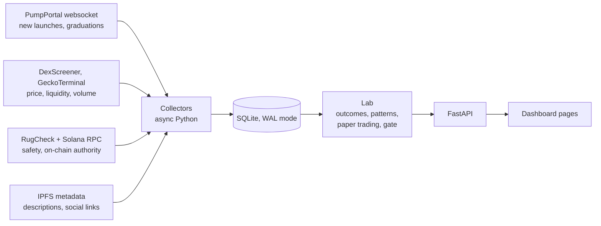

# Token Launch Research Lab

A real-time data pipeline and research dashboard that tracked every new token launch on Solana's
pump.fun launchpad, recorded what happened to each one, and tested 10 trading strategies with
**paper money** against a pass/fail gate set before the test began.

**Result:** after 29 days and 15,329 simulated trades, **no strategy passed.** Every one lost money
after realistic costs. The system did its job: it ruled out a losing idea before any real money was
at risk.

> Research project only. No wallet, no private keys, no real orders. Nothing was ever bought or sold.

---

## Why I built it

Thousands of tokens launch on Solana every day, and social media is full of claims that simple
rules ("buy safe tokens right after they graduate") make money. I wanted to test those claims with
data instead of anecdotes, and to practice building a system that collects messy live data and
turns it into decisions I can defend.

## What it does

| Feature | Description |
| --- | --- |
| **Live ingestion** | Streams every new launch over a websocket and polls four REST APIs for prices, liquidity, volume and safety data, all through a shared rate limiter with caching and backoff |
| **Outcome tracking** | Re-checks every token at 1 m, 5 m, 15 m, 1 h, 4 h, 24 h, 72 h and 7 d, then labels its peak and its fate at day 7 |
| **Safety checks** | Combines a third-party risk API with on-chain reads of mint and freeze authority; the chain wins when they disagree |
| **Dashboard** | Live launches, a momentum ranking, token detail drawer with chart, a Patterns page (by theme, launch hour, weekday) and a Data-quality page |
| **Paper-trading engine** | Runs 10 strategies (YAML files) side by side with deliberately harsh fees, slippage and failure assumptions |
| **Go / no-go gate** | Each strategy is judged automatically against fixed pass criteria (below) |
| **Data-quality guards** | Logs every outage, excludes trades affected by missing data, versions each strategy's rules so changed rules never mix with old results |
| **Operations** | Stall watchdog with auto-reconnect, sleep detection, daily compressed database backups with restore commands, data-retention policy |

## Architecture



**Stack:** Python 3.11+, asyncio, FastAPI, httpx, websockets, SQLite, vanilla HTML/JS, pytest, uv.
About 5,700 lines of application code and 175 automated tests.

## How the strategy test worked

1. **Define the pass criteria first.** A strategy passes only if, on its current rules version, it has
   - at least 21 days and 200 closed trades
   - a profit after all costs
   - a median trade no worse than −10%
   - a profit even without its 2 best trades
   - a higher average return per trade than the "Safety only" benchmark
   - a profit in both halves of the test period
2. **Use pessimistic costs.** Trading fees from the exchange's published fee table, network fees,
   slippage modelled from pool depth (counted twice, plus 1%), 10% of entries treated as failed,
   10% of exits filled one price late, and fills always at the *next* price, never the trigger price.
3. **Compare against a benchmark.** Every filter is measured against "Safety only", so a strategy
   can't look good just because the whole market went up.
4. **Protect the data.** Trades that went 5+ minutes without a price (laptop asleep, API outage)
   are shown separately and excluded from the gate. Any change to a strategy's rules starts a new
   version with a fresh clock.

## Results

Test window: Oct 20 – Nov 18, 2026 (29 days). 0.5 SOL per simulated trade.
Every result includes exchange fees, network fees and modelled slippage on both the buy and the sell (see `buy()`, `sell()` and `_close()` in `radar/lab/shadow.py`).

| Strategy | Trades | Hit rate | Median trade | Mean trade | Profit (SOL) | Gate |
| --- | ---: | ---: | ---: | ---: | ---: | --- |
| Every graduation\* | 4,049 | 21% | −62% | −40% | −819 | Fail |
| Safety only (benchmark) | 1,901 | 17% | −65% | −46% | −439 | Fail |
| Momentum + safety | 1,811 | 17% | −70% | −49% | −447 | Fail |
| Social links + safety | 1,044 | 17% | −62% | −46% | −237 | Fail |
| Clean deployer | 1,844 | 17% | −70% | −48% | −442 | Fail |
| After the boost window | 474 | 19% | −53% | −41% | −98 | Fail |
| Buyers not leaving | 221 | 26% | −52% | −28% | −31 | Fail |
| Full stack (all filters) | 108 | 28% | −47% | −15% | −8 | Fail (too few trades, and unprofitable) |
| Early de-risk (exit test) | 1,921 | 21% | −37% | −36% | −341 | Fail |
| No-progress timeout (exit test) | 1,955 | 24% | −52% | −38% | −370 | Fail |

\*Excludes one glitch trade: an API briefly reported ChimpX AI at a $196M market cap with $52 of
volume, and the simulator "sold" into that phantom price for +705 SOL. Including it, this strategy's
mean was −6% and its loss 114 SOL. It failed the gate either way.

## What I learned

- **Selection matters more than exits.** Most losing trades collapsed in one step between two
  price checks about 25 seconds apart. At the day-14 review, the benchmark's stopped-out trades
  sold at a median of about 90% below entry, so faster stops wouldn't have helped.
- **Filters reduced losses but never created a profit.** The strictest filter cut the average loss
  from −46% to −15% per trade, but also cut the number of trades by about 94%.
- **Bad data can look like a great strategy.** One phantom price turned a large loss into an
  apparent profit. Any big win has to be checked trade by trade, and a future version needs an
  outlier guard.
- **Infrastructure is part of the result.** A sleeping laptop and API outages cost a meaningful
  share of data in the first two weeks, which is why outages are logged and excluded rather than
  ignored.
- **A negative result is still a result.** The gate exists so that a decision about real money
  comes from evidence, not from a few exciting trades.

## Limitations

- Prices come from free APIs every 20 to 60 seconds; a real trading system would need much faster data.
- Results come from one 29-day market period.
- Social links are only checked for presence, not authenticity.
- Creator history only covers launches the app saw while running.

## Run it locally

Requires [uv](https://docs.astral.sh/uv/) and Python 3.11+. All data sources used are free and need no API keys.

```bash
uv run python -m radar        # start collectors + dashboard at http://localhost:8000
uv run pytest                 # run the test suite
uv run python -m radar.lab.export   # export paper trades to CSV (data/exports/)
```

Pages: `/` dashboard, `/data` data quality, `/patterns` patterns, `/shadow` paper trading and the gate.
Settings live in `config/settings.yaml`; strategies are YAML files in `strategies/`.
Copy `.env.example` to `.env` only if you add optional keys. `.env` and all collected data are git-ignored.

## Project structure

```
radar/collectors/   one module per data source (websocket + REST)
radar/http.py       shared rate limiter, cache and backoff for every API call
radar/lab/          outcomes, graduation rule, outage tracking, paper trading, gate statistics
radar/scoring/      momentum score, bot-volume flag, theme tags
radar/db/           SQLite schema and data access
radar/api/          FastAPI app and JSON endpoints
static/             dashboard pages
strategies/         one YAML file per paper-trading strategy
tests/              pytest suite
```

## Data sources (all free)

| Source | Used for |
| --- | --- |
| PumpPortal websocket | New launches and graduation events |
| DexScreener, GeckoTerminal | Prices, liquidity, volume, buy/sell counts, charts |
| RugCheck | Third-party safety reports |
| Solana public RPC | On-chain mint and freeze authority |
| IPFS gateways | Token descriptions and social links |

## How it was built

I designed and directed the project, and wrote the code with Claude Code as a pair programmer.
`CLAUDE.md` is the original spec and the working rules (for example, no wallet or trading code,
secrets only in `.env`, commit after each working step). `PROGRESS.md` is the build log, with the
decisions made along the way.

## Disclaimer

This is a research and learning project, not financial advice. It never connects a wallet and
cannot place trades.
